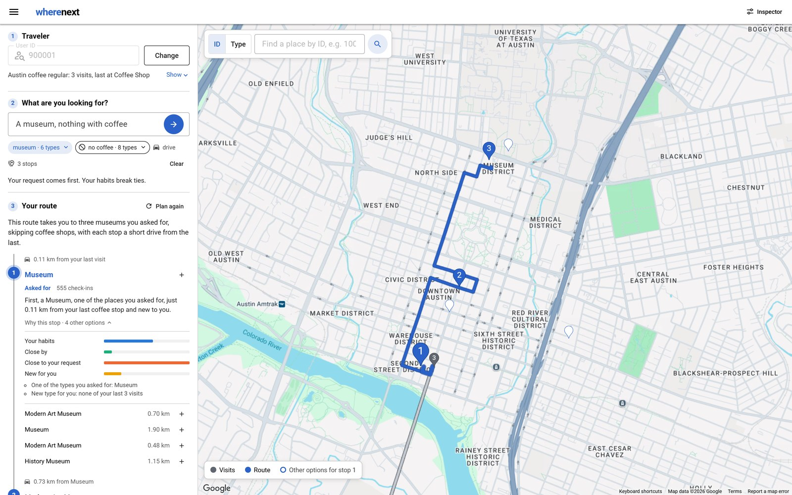

# WhereNext: Interactive Semantic-Spatial POI Exploration



*The main screen. The request "A museum, nothing with coffee" is read into place types and a travel mode, planned as a three-stop drive, and drawn on the map; the first stop shows why it was chosen and the other options.*

WhereNext is a runnable full-stack demo system for interactive Point-of-Interest (POI) exploration.
A traveler states a request in their own words ("a museum, nothing with coffee"), and a session-based next-POI recommender plans a route around it: places of the requested types within reach decide each stop, and the traveler's habits rank among them. Each stop carries an evidence record whose parts add up to its score; an LLM writes the explanation from that record alone, and a verifier checks every sentence against it and removes the ones it finds unsupported.

Users can load or edit a POI trajectory, type a request, plan a multi-stop route, inspect each stop's evidence on a Google Map, and read checked, route-level explanations.

> This repository contains the runnable demo system.
> It is not the full offline training or benchmark evaluation repository.

---

## Features

* Load user trajectories by user ID, or pick a demo traveler.
* Display observed POI visits on a map; search POIs and add or remove them.
* Read a free-text request into dataset place types, travel mode, distance and wording (Claude, with a keyword parser as the offline fallback).
* Plan a request-first route: the request decides each stop when it can be met within reach, habit ranks among the fitting places, and travel and repetition costs shape the route.
* Show each stop's score parts and other options ("Why this stop"), and an Inspector view with weights and stage timings.
* Draw road routes with the Google Routes API.
* Write route explanations whose sentences cite the evidence, and remove sentences a rule-based verifier finds unsupported.
* Apply semantic-spatial reranking on top of a deployed SBR backbone.

---

## System Components

WhereNext consists of four main components:

1. **Vue/Vite Frontend**
   Provides the map-centered interface, trajectory editing, POI search, recommendation display, and explanation panel.

2. **Flask Backend**
   Provides REST APIs for user history, POI lookup, recommendation, route planning, and LLM explanation.

3. **Recommendation Service**
   Uses a deployed session-based recommendation backbone to generate candidate POIs.

4. **Semantic-Spatial Reranking**
   Refines backbone-generated candidates using spatial retrieval and semantic similarity before returning hydrated POI objects to the frontend.

The current demo deploys **MG-DSGAT** as the SBR candidate-generation backbone. The system is designed so that other SBR backbones can be adapted by replacing the model adapter that maps user trajectories to ranked raw POI IDs.

---

## Repository Structure

```text
WhereNext/
├── frontend/                         # Vue/Vite frontend
│   ├── src/
│   │   ├── App.vue                    # Main frontend orchestration
│   │   ├── main.ts                    # Frontend entry point
│   │   └── components/
│   │       ├── UserLogin.vue          # User ID input and trajectory loading
│   │       ├── HistoryList.vue        # Observed visit list
│   │       ├── SearchPanel.vue        # POI search interface
│   │       ├── RecommendPanel.vue     # Recommendation cards
│   │       ├── MapCanvas.vue          # Google Map, markers, and info windows
│   │       ├── DrawRoute.vue          # Route polyline rendering
│   │       ├── ChatPanel.vue          # LLM rationale display
│   │       └── POIDetailDialog.vue    # POI semantic/spatial profile dialog
│   ├── package.json
│   └── vite.config.mts
│
├── backend/                          # Flask backend
│   ├── app.py                         # Backend entry point
│   ├── database.py                    # SQLAlchemy models
│   ├── json_to_db.py                  # Build SQLite DB from metadata
│   ├── routes/
│   │   ├── user_api.py                # User history APIs
│   │   ├── poi_api.py                 # POI search/detail APIs
│   │   ├── model_api.py               # Recommendation API
│   │   ├── route_api.py               # Google Routes API proxy
│   │   └── chat_api_multi.py          # LLM route explanation API
│   ├── contracts/                     # Pydantic schemas: Intent, RouteEvidence, explanations
│   ├── services/
│   │   ├── recommendation_service.py  # Request-level recommendation pipeline
│   │   ├── model_config.py            # Model and artifact configuration
│   │   ├── latest_model_adapter.py    # MG-DSGAT adapter and reranking logic
│   │   ├── intent_parser.py           # Claude request parser and keyword fallback
│   │   ├── intent_signal.py           # Graded relevance of each place to the request
│   │   ├── steering.py                # Request-first filter and habit within the request
│   │   ├── route_planner.py           # Travel and repeat costs per stop
│   │   ├── evidence_builder.py        # Per-stop evidence records
│   │   ├── grounded_explainer.py      # Claude explanations from the evidence
│   │   ├── explanation_verifier.py    # Checks every sentence against what it cites
│   │   └── visit_store.py             # Visit storage; demo travelers stay in memory
│   ├── model_core/
│   │   └── MG-DSGAT/                  # Deployed SBR backbone implementation
│   ├── datasets/                      # POI metadata and mapping files
│   ├── tests/                         # Unit tests (pytest)
│   ├── pyproject.toml
│   └── uv.lock
│
├── experiments/                      # Offline evaluations: design, predictions, results
│
└── README.md
```

---

## Prerequisites

### Frontend

* Node.js 20 or newer is recommended.
* npm

### Backend

* Python 3.13 or newer
* uv
* SQLite
* PyTorch-compatible environment

The backend can run on CPU, but GPU inference is recommended for faster recommendation.

---

## Configuration

### Frontend Environment

Create a frontend environment file:

```bash
cp frontend/.env.example frontend/.env
```

Example `frontend/.env`:

```env
VITE_GOOGLE_API_KEY=your_google_maps_api_key
VITE_API_BASE_URL=http://127.0.0.1:5000/api
```

### Backend Environment

Create a backend environment file:

```bash
cp backend/.env.example backend/.env
```

Example `backend/.env`:

```env
ANTHROPIC_API_KEY=your_anthropic_api_key
GOOGLE_MAPS_API_KEY=your_google_maps_api_key

DATABASE_URL=sqlite:///app.db
FLASK_HOST=127.0.0.1
FLASK_PORT=5000

WHERENEXT_MODEL_REPO=backend/model_core/MG-DSGAT
WHERENEXT_MODEL_CHECKPOINT=backend/model_core/MG-DSGAT/checkpoints/weight.pt
WHERENEXT_RAW2ITEM_JSON=backend/model_core/MG-DSGAT/datasets/Gowalla/raw_location2item.json
WHERENEXT_ITEM2RAW_JSON=backend/model_core/MG-DSGAT/datasets/Gowalla/item2raw_location.json
WHERENEXT_POI_METADATA_JSON=backend/model_core/MG-DSGAT/datasets/Gowalla/filtered_poi_metadata.json
WHERENEXT_SEMANTIC_EMBEDDING_PATH=backend/model_core/MG-DSGAT/artifact/Gowalla/poi_semantic_embeddings.pt

WHERENEXT_DEVICE=cpu
WHERENEXT_MODEL_TOP_K=20
WHERENEXT_RETURN_TOP_K=5
WHERENEXT_ENABLE_SPATIAL=true
WHERENEXT_ENABLE_SEMANTIC=true
WHERENEXT_SEMANTIC_MODE=single
```

Do not commit real `.env` files or API keys.

### Demo Travelers and Inspector

The traveler step offers demo travelers (`frontend/src/demo.ts`), each with requests that show its case well. Picking one replaces the visits of its reserved user ID (900001 and 900002). Visits of reserved IDs (900000 and up) are kept in the backend's memory only, so loading or editing a demo traveler writes nothing to the database, and a restart forgets it. At a booth, set `WHERENEXT_BOOTH=true` in `backend/.env`: edits to any other user are then refused, so nothing a visitor does reaches the database. The **Inspector** button in the top bar shows score numbers, weights and pipeline timings; visitors see the bars and sentences without them. Add `?inspector=1` to the URL to open the app with the Inspector on.

### Google Maps Setup

The map and the road routes use two Google APIs, enabled in one Google Cloud project with billing turned on:

- **Maps JavaScript API** draws the map. Its key is `VITE_GOOGLE_API_KEY` in `frontend/.env`; restrict it to your site's HTTP referrers. The stop pins need a vector map ID from the same project; set it as `VITE_GOOGLE_MAP_ID` if the map stays grey or the pins do not appear.
- **Routes API** turns each leg of a route into a road path. Its key is `GOOGLE_MAPS_API_KEY` in `backend/.env`, read by `POST /api/route/` on the server; do not restrict it to referrers.

Legs follow the request's travel mode (drive, walk or transit; transit falls back to walking where there is no service). The backend caches each leg it has fetched, so redrawing the map does not call Google again. Without a key, or when Google finds no route, the map joins the stops with dashed straight lines, and the browser console says why.

---

## Required Artifacts

The runnable demo requires several data and model artifacts.

| Artifact                    | Expected Path                                                             | Required                   |
| --------------------------- | ------------------------------------------------------------------------- | -------------------------- |
| POI metadata                | `backend/datasets/filtered_poi_metadata.json`                             | Yes                        |
| Raw-to-internal POI mapping | `backend/model_core/MG-DSGAT/datasets/Gowalla/raw_location2item.json`     | Yes                        |
| Internal-to-raw POI mapping | `backend/model_core/MG-DSGAT/datasets/Gowalla/item2raw_location.json`     | Yes                        |
| SQLite database             | `backend/instance/app.db`                                                 | Generated                  |
| MG-DSGAT checkpoint         | `backend/model_core/MG-DSGAT/checkpoints/weight.pt`                       | Yes for recommendation     |
| Semantic POI embeddings     | `backend/model_core/MG-DSGAT/artifact/Gowalla/poi_semantic_embeddings.pt` | Yes for semantic reranking |

Large model artifacts such as `.pt` checkpoints and semantic embeddings should not be tracked directly in normal Git history. Use Git LFS, GitHub Release assets, Zenodo, or an external download link.

---

## Installation

Clone the repository:

```bash
git clone https://github.com/chengruchou/WhereNext.git
cd WhereNext
```

Install backend dependencies (this includes PyTorch and `sentence-transformers`, which scores how well each place fits a request):

```bash
cd backend
uv sync
```

Download the pretrained model checkpoint from the following [link](https://drive.google.com/file/d/1TOCfHrGnm9WyyLQV_lV2U43T0ccYDL2B/view?usp=drive_link)


Place the downloaded checkpoint file under the following directory:

```bash
backend/model_core/MG-DSGAT/checkpoints/
```

The expected checkpoint path is:

```bash
backend/model_core/MG-DSGAT/checkpoints/weight.pt
```

Install frontend dependencies:

```bash
cd ../frontend
npm install
```

---

## Prepare the Database

From the backend directory, build the local SQLite database from the POI metadata file:

```bash
cd backend
uv run python json_to_db.py
```

This creates the local database used by the Flask backend.

---

## Run the Backend

From the backend directory:

```bash
cd backend
uv run python app.py
```

By default, the backend runs at:

```text
http://127.0.0.1:5000
```

---

## Run the Frontend

From the frontend directory:

```bash
cd frontend
npm run dev
```

Open the local frontend URL shown by Vite, for example:

```text
http://localhost:3000/
```

---

## Run the Tests

The backend unit tests cover the explanation verifier, the keyword parser, steering and visit storage. They need no model files or API keys:

```bash
cd backend
uv run --with pytest python -m pytest tests
```

The frontend type check:

```bash
cd frontend
npm run type-check
```

---

## Experiments

`experiments/` holds the offline evaluations. Each Markdown file is a design document: the question, the data, the metrics and the predictions, written before the run, followed by the results and which predictions held. Each script's docstring shows how to run it. They need the MG-DSGAT checkpoint, the semantic embeddings (set through the `WHERENEXT_*` variables) and the Gowalla test split, and call no external API.

| ID | Question |
|---|---|
| E-B, E-B2 | Within a request, does habit find the place the user actually visited next better than nearest-first or popularity? |
| E-C, E-C2 | Keep only the requested types, or weigh the request against habit? What if the request is not the answer? |
| E-D1 | Does the verifier remove sentences with planted errors and keep true ones? |
| E-A1 | How well does the keyword parser read requests with known answers? |
| E-E | How long does each stage take on a CPU? |
| E-F | Without a request, do reranking and route costs keep accuracy and reduce repetition? |
| E-G, E-G2 | Do the wording-derived weights change routes? Where does an unmet request send the traveler? |
| E-N | Does "somewhere new" change routes when no type is requested? |
| E-R | Do E-B and E-F hold with intervals resampled over sessions? |

---

## Demo Workflow

A typical WhereNext demo follows this workflow:

1. Pick a demo traveler, or enter a user ID and load the user trajectory.
2. Inspect the visits in the history panel and on the map; search, add or remove places if needed.
3. Type a request, or pick an example. Its place types, travel mode and weights appear as chips that can be edited.
4. Click **Plan route**. Each stop shows its checked sentence; "Why this stop" shows the score parts and the other options on the map.
5. If nothing of the requested types is within reach, the panel says so and the stops follow the traveler's habits within reach.
6. Turn on the **Inspector** to see score numbers, weights and stage timings.

---

## API Overview

### User History APIs

Used for loading, adding, and deleting user visit histories. Visits of the reserved demo IDs (900000 and up) are kept in memory, not in the database; with `WHERENEXT_BOOTH=true`, changes to other users return 403.

```text
GET    /api/user/...
POST   /api/user/...
DELETE /api/user/...
```

### POI APIs

Used for POI search and POI detail retrieval.

```text
GET /api/poi/...
```

### Recommendation API

Used when the frontend requests next-POI recommendations.

```text
POST /api/model/genpoi/<user_id>
```

The backend retrieves the user trajectory, maps raw POI IDs to internal item IDs, runs the deployed SBR backbone, applies spatial and semantic reranking, hydrates the final POI objects, and returns them to the frontend.

### Request and Route Recommendation API

Used when the user describes what they want and asks for a multi-stop route.

```text
POST /api/intent/parse
POST /api/model/route/<user_id>
```

`/api/intent/parse` turns a request such as "museums, nothing with coffee" into an `Intent` whose place types exist in the POI data. `/api/model/route/<user_id>` plans every stop in one call and returns the candidates per stop with per-stop evidence: score parts, distance from the previous stop, and whether each pipeline stage ran.

When places of the requested types are within reach of the previous stop, only those are kept, so the request decides each stop and the user's habits rank within it. Reach is the request's own distance limit, else it depends on the travel mode. When nothing of the requested types is within reach, the stops follow the user's habits among the places within reach (the five nearest if none is), and the evidence says so. Within the request, the sequence model scores every kept place, so each one carries the same habit and closeness signals.

```text
WHERENEXT_REACH_WALK_KM=2
WHERENEXT_REACH_TRANSIT_KM=15
WHERENEXT_REACH_DRIVE_KM=40
WHERENEXT_INTENT_FILTER=true                 # false ranks by the weighted score alone
WHERENEXT_UNMET_WITHIN_REACH=true            # false: an unmet request lets habit pick from any distance
WHERENEXT_INTENT_K=100                       # places of the requested types added per step
WHERENEXT_INTENT_HABIT_SCORING=true          # false: habit only for the model's own top candidates
WHERENEXT_INTENT_HABIT_NORMALIZATION=minmax  # or relative / softmax; see experiments/E-B2
```

How well this ranking finds the place a user actually visited next, against nearest-first and most-visited baselines, is measured in `experiments/` (E-B and E-B2); how the filter compares with weighting the request against habit, in E-C and E-C2.

### Route Planning API

Used by the frontend to request planned routes.

```text
POST /api/route/
```

This endpoint proxies route-planning requests to the Google Routes API and returns route geometry for frontend visualization.

### LLM Explanation API

Used to generate route-level recommendation rationales.

```text
POST /api/chat/grounded
POST /api/chat/explain
```

`/api/chat/grounded` takes a route's evidence and returns sentences that each cite the evidence values they rely on. Every sentence is checked against what it cites: each number must match a cited field of its kind (a distance in km, m or miles, a visit count) for the same stop, a stop may not be called a type it is not, "often" and "new to you" must agree with the visit counts, and attributes or comparisons the data cannot show (ratings, prices, popularity, "the closest") are not allowed. Sentences the data does not support are dropped, and the response says how many were checked, could not be checked, and were dropped. E-D1 in `experiments/` measures this on sentences with planted errors. `/api/chat/explain` returns a free-text Markdown explanation built from the historical and recommended POIs.

---

## Recommendation Pipeline

The recommendation pipeline proceeds as follows:

1. The server retrieves the user’s current trajectory.
2. Raw Gowalla POI IDs are mapped to internal item IDs.
3. The deployed SBR backbone generates candidate next POIs.
4. Candidate internal item IDs are decoded back to raw POI IDs.
5. BallTree-based spatial retrieval expands geographically plausible POIs.
6. Semantic reranking compares candidates with the user’s recent semantic profile.
7. Final ranked candidates are hydrated with POI metadata.
8. The frontend receives POI objects for map-based interaction and explanation.

---

## Notes on the Model Backbone

The current demo implementation deploys MG-DSGAT as the session-based recommendation backbone. MG-DSGAT is used as a black-box candidate generator in this system.

WhereNext itself does not propose a new SBR architecture. Instead, it demonstrates how a deployed SBR backbone can be connected with semantic-spatial reranking, map-based interaction, route visualization, and LLM-based explanation.

The system design can be adapted to other SBR backbones if they provide ranked candidate POIs that can be mapped back to raw POI identifiers.

---

## Notes on Google Maps and LLM APIs

WhereNext uses the Google Maps API for map rendering, marker display, and route planning. A valid Google Maps API key is required.

WhereNext uses the Claude API to read natural-language requests (`/api/intent/parse`) and to write route-level explanations (`/api/chat/grounded` and `/api/chat/explain`). Both use `claude-opus-5-5` by default; set `WHERENEXT_INTENT_MODEL` or `WHERENEXT_EXPLAIN_MODEL` to change the model. Credentials come from `ANTHROPIC_API_KEY` (or an `ant auth login` profile). Without them, request parsing falls back to a built-in keyword parser and explanations are unavailable.

LLM outputs may vary across runs. They are intended for qualitative route explanation and should not be treated as benchmark evidence.

API calls to Google Maps and LLM providers may incur cost depending on your account and usage.

---

## Troubleshooting

### Requests are read by the keyword parser, or explanations are unavailable

Set `ANTHROPIC_API_KEY` in `backend/.env` and restart the backend. The `parser` field returned by `/api/intent/parse` shows which parser ran.

### Google Map does not load

Check that `VITE_GOOGLE_API_KEY` is correctly set in `frontend/.env`.

### Routes are dashed straight lines instead of roads

The map could not get road paths. The browser console logs the backend's reason: usually `GOOGLE_MAPS_API_KEY` is missing from `backend/.env` (restart the backend after adding it), or the Routes API is not enabled for the key's project, in which case the backend log shows Google's error.

### Recommendation endpoint fails because checkpoint is missing

Make sure the MG-DSGAT checkpoint exists at:

```text
backend/model_core/MG-DSGAT/checkpoints/weight.pt
```

or set `WHERENEXT_MODEL_CHECKPOINT` to the correct path.

### Semantic reranking is skipped or fails

Make sure the semantic embedding file exists at:

```text
backend/model_core/MG-DSGAT/artifact/Gowalla/poi_semantic_embeddings.pt
```

or set `WHERENEXT_SEMANTIC_EMBEDDING_PATH` to the correct path.

---

## Open-Source Scope

This repository focuses on the runnable WhereNext demo system. It does not include the full offline training, benchmark evaluation, or reproduction pipeline for all reported baselines.

For academic results, please refer to the paper. If a separate evaluation repository is released, link it here.

---

## Citation

<!-- If you use this system, please cite:

```bibtex
@inproceedings{chou2026wherenext,
  title     = {WhereNext: An Interactive Semantic-Spatial System for Point-of-Interest Exploration},
  author    = {Chou, Cheng-Ru and Cai, Zong-Ze and Lin, Ting-Hsuan and Liu, Kuan-Yu and Li, Pei-Xuan and Tsai, Shou-Po and Hsieh, Hsun-Ping and Yen, I-Hsuan},
  booktitle = {Proceedings of the 35th International ACM Conference on Knowledge and Information Management},
  year      = {2026}
}
``` -->

The deployed SBR backbone is based on MG-DSGAT:

```bibtex
@inproceedings{li2025mgdsgat,
  title     = {Session-Based Recommendation with Multi-granularity User Intent and Dual-Channel Sparse Graph Attention Networks},
  author    = {Li, Pei-Xuan and Lin, Chia-Lung and Hsieh, Hsun-Ping},
  booktitle = {Advances in Knowledge Discovery and Data Mining},
  year      = {2025},
  pages     = {265--277},
  doi       = {10.1007/978-981-96-8180-8_21}
}
```

---

## License

Please add a license before public release. Common options for academic demo systems include MIT, Apache-2.0, or BSD-3-Clause. Make sure the selected license is compatible with third-party dependencies and model artifacts.
